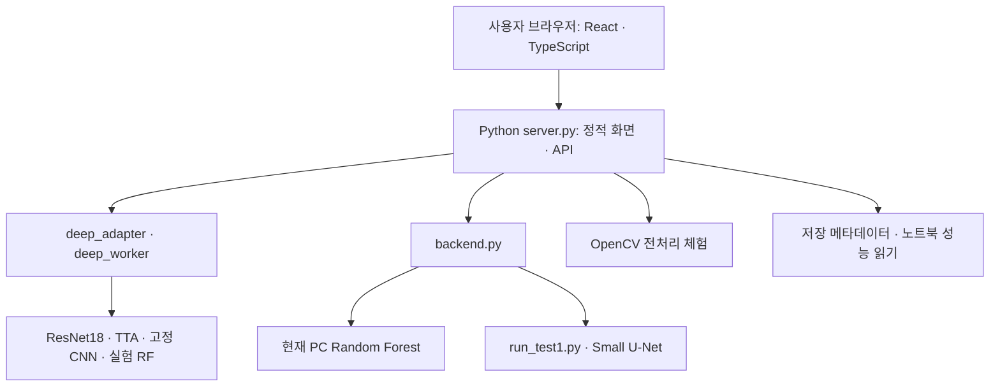

# SteelVision ML 프로젝트 상세 설명

작성일: 2026-11-06  
작성 기준: 프로젝트에 보존된 실제 코드, 모델 메타데이터, 학습 설명 및 평가 기록

## 1. 프로젝트 개요

**SteelVision ML은 철강 표면 이미지를 분석해 정상·불량 의심을 판정하고, 별도의 분할 모델로 결함 위치를 확인하는 웹 기반 품질 검수 프로젝트다.**

철강 표면의 결함을 놓치는 오류를 줄이면서, 정상 제품에 불필요한 재검사 경보가 발생하는 정도도 함께 비교한다. 데이터 탐색, 영상 전처리 체험, 실제 모델 추론, 결함 위치 시각화, 성능 비교, 결과 다운로드를 하나의 웹 화면에서 제공한다.

| 항목 | 내용 |
| --- | --- |
| 프로젝트명 | SteelVision ML |
| 분석 대상 | Severstal 철강 표면 이미지와 결함 주석 |
| 주된 과제 | 이미지 단위 정상·결함 이진 판정 |
| 최종 검수 모델 | **ImageNet 사전학습 ResNet18 미세조정 + 좌우반전 TTA** |
| 별도 위치 분석 모델 | **Small grayscale U-Net, base=16** |
| 비교 기준 모델 | Random Forest, 고정 CNN 특징 + Logistic Regression 등 |
| 최종 웹 구성 | React·TypeScript 화면 + Python 추론 API |
| 기본 실행 주소 | <http://127.0.0.1:8502> |

이 문서는 프로젝트의 목적과 최종 모델을 설명한다. 실행 순서는 [03_실행방법.md](03_실행방법.md), 구현·검증 이력은 [02_작업상세.md](02_작업상세.md)에서 확인할 수 있다.

## 2. 해결하려는 문제와 평가 기준

검수에서 중요한 오류는 다음 두 가지다.

- **FN, 불량 누락:** 실제 결함 이미지를 정상으로 통과시키는 경우.
- **FP, 정상 오탐:** 정상 이미지에 결함 경보를 울려 재검사 대상으로 보내는 경우.

이번 모델 선택은 **검증 데이터에서 기존 RF의 오탐 상한을 지키면서 불량 검출률을 최대화하는 것**을 우선했다. 전체 정확도만 높이는 방식과는 평가 목적이 다르다.

| 지표 | 계산식 | 해석 |
| --- | --- | --- |
| Recall, 재현율 | `TP / (TP + FN)` | 실제 불량 중 찾아낸 비율 |
| Precision, 정밀도 | `TP / (TP + FP)` | 불량 경보 중 실제 불량의 비율 |
| Accuracy, 정확도 | `(TP + TN) / 전체 수` | 정상·불량 전체에서 맞힌 비율 |
| F1 | `2 × TP / (2 × TP + FP + FN)` | 정밀도와 재현율을 함께 요약한 값 |
| 재검사 권고량 | `TP + FP` | 불량 의심으로 분류한 이미지 수 |

TP는 실제 불량을 불량으로 검출한 수, TN은 실제 정상을 정상으로 판정한 수다. 뒤에서 제시하는 **99.70%는 전체 정확도가 아니라 불량 Recall**이다.

## 3. 데이터 구성과 분할

### 3.1 원본 데이터

철강 표면 이미지의 원본 크기는 **가로 1600 × 세로 256픽셀**이다. `train.csv`에는 `ImageId`, `ClassId`, `EncodedPixels`가 저장되어 있다. `EncodedPixels`는 결함 영역을 RLE, 즉 연속 구간 길이 방식으로 표현한 주석이다.

| 구분 | 수량 |
| --- | ---: |
| 전체 학습용 원본 이미지 | 12,568장 |
| 결함 이미지 | 6,666장 |
| 정상 이미지 | 5,902장 |
| 결함 주석 행 | 7,095행 |
| Class 1 주석 | 897행 |
| Class 2 주석 | 247행 |
| Class 3 주석 | 5,150행 |
| Class 4 주석 | 801행 |

한 이미지에 여러 결함 유형이 있을 수 있어 주석 행 수와 결함 이미지 수는 다르다. 유형은 저장된 Class 1~4를 사용하며, 프로젝트에서 확인되지 않은 결함 명칭을 임의로 대응하지 않는다.

### 3.2 이미지 판정 모델의 분할

정상·결함 비율을 고려한 약 60%·20%·20% 분할이며 난수 시드는 42다. 딥러닝 실험은 기존 ML 실험의 이미지 ID 분할을 재사용했다.

| 분할 | 전체 | 결함 | 정상 | 용도 |
| --- | ---: | ---: | ---: | --- |
| 학습 | 7,540 | 3,999 | 3,541 | 가중치와 특징 표준화 통계 학습 |
| 검증 | 2,514 | 1,334 | 1,180 | 체크포인트·후보 모델·임계값 선택 |
| 홀드아웃 | 2,514 | 1,333 | 1,181 | 선택 후 RF와 성능 비교 |

학습 설명에는 분할 사이의 이미지 ID 및 파일 SHA-256 중복을 확인했다고 기록되어 있다. 생산 코일·로트별 분할이나 유사 이미지까지 제거한 분할을 의미하지는 않는다. 홀드아웃은 이전 분석에서 이미 관찰한 데이터이므로 후속 비교 결과로 해석한다.

### 3.3 모델별 정답의 차이

- **이미지 판정:** 결함 주석이 하나라도 있으면 1, 없으면 0으로 구성한다.
- **CNN 보조 학습:** Class 1~4의 존재 여부를 `[1, 0, 1, 0]`과 같은 4개 값으로 구성한다. 여러 유형이 동시에 존재할 수 있는 다중 라벨이다.
- **U-Net 위치 학습:** RLE 주석을 픽셀 마스크로 복원하고 모든 결함 유형을 하나의 결함 전경으로 합쳐 사용한다.

최종 ResNet18은 픽셀별 정답 마스크를 손실에 사용하지 않는다. 픽셀 위치를 학습하는 모델은 별도의 U-Net이다.

## 4. 최종 모델: ResNet18 미세조정 + TTA

### 4.1 최종 구성

최종 후보 이름은 **`CNN_finetuned_TTA`**이며 웹의 기본 선택은 **`resnet18_tta`**, 운영점은 **`RF_same_FP_budget`**이다.

```text
원본 이미지
  → OpenCV 회색조 디코딩
  → 800×128 축소
  → 픽셀 / 255
  → 같은 회색조를 3채널로 복제
  → ImageNet 평균·표준편차 정규화
  → ImageNet 사전학습 ResNet18의 특징 추출부
  → 전체 평균 풀링 512개 + 전체 최대 풀링 512개
  → 1,024차원 특징
  → 이진 출력층
  → 원본 방향·좌우반전의 sigmoid 점수 평균
  → 저장된 임계값과 비교
  → 정상 / 불량 의심
```

최종 경보 점수에는 RF 점수를 섞지 않는다. RF와 CNN의 가중평균 후보도 비교했지만, 최종 선택은 CNN과 TTA만 사용하는 구성이다.

### 4.2 입력 전처리

| 단계 | 실제 처리 |
| --- | --- |
| 디코딩 | OpenCV 회색조 읽기 |
| 크기 변경 | `800×128`, `cv2.INTER_AREA` |
| 값 범위 변환 | `float32`로 변환 후 255로 나누기 |
| 채널 | 회색조를 3번 복제 |
| 평균 정규화 | `[0.485, 0.456, 0.406]` |
| 표준편차 정규화 | `[0.229, 0.224, 0.225]` |

전체 영상을 축소해 원본의 종횡비를 유지한다. 모델 입력에는 CLAHE·Canny·Sobel 영상이나 웹 전처리 체험 결과를 추가하지 않는다.

### 4.3 신경망 구조

ResNet18의 원래 1,000개 범주 분류층을 제거하고, 마지막 특징맵에 전체 평균 풀링과 전체 최대 풀링을 적용한다. 각 풀링의 512개 특징을 연결해 1,024개 특징을 만든다.

학습 구조에는 `Dropout(p=0.10)`과 두 출력층이 있다.

- `binary_head: Linear(1024 → 1)` — 이미지 결함 유무 logit.
- `class_head: Linear(1024 → 4)` — 학습을 돕는 유형별 존재 여부 logit.

평균 풀링은 전체적인 특징을 요약하고, 최대 풀링은 좁은 영역의 강한 반응을 남기려는 설계다. 실제 검수 화면에는 이진 판정만 제공한다. 보조 출력층이 있다는 사실을 결함 유형 분류 기능이나 검증된 유형 분류 정확도로 설명하지 않는다.

### 4.4 학습 방법

**1단계는 고정 CNN 특징에 선형분류기를 학습하는 과정이다.** ImageNet 사전학습 ResNet18을 고정한 상태에서 1,024차원 특징을 추출하고, 학습 분할에 `StandardScaler + LogisticRegression`을 학습했다.

로지스틱 회귀 설정은 `C=0.1`, `class_weight='balanced'`, `max_iter=2500`, `random_state=42`다. 학습된 표준화 통계와 회귀 계수를 CNN의 이진 출력층에 맞는 형태로 변환해 초기값으로 복사했다.

**2단계는 CNN 후반부 미세조정이다.** `layer3`, `layer4`, `binary_head`, `class_head`를 학습하고 초기 합성곱과 `layer1`, `layer2`의 파라미터는 고정했다. 모든 BatchNorm의 누적 평균·분산은 갱신하지 않았다. 학습 대상 후반부 BatchNorm의 스케일·바이어스는 학습 가능하다.

| 설정 | 값 |
| --- | --- |
| 난수 시드 | 42 |
| 학습 배치 | 12장 |
| 특징 추출·일반 추론 배치 | 16장 |
| 최대 epoch | 12 |
| 조기종료 patience | 4 |
| 실제 학습 기록 | 9 epoch |
| 최종 선택 체크포인트 | **5번째 epoch** |
| Optimizer | AdamW |
| `layer3`·`layer4` 초기 학습률 | `1e-4` |
| 출력층 초기 학습률 | `5e-4` |
| Weight decay | `1e-4` |
| 학습률 스케줄러 | CosineAnnealingLR, `T_max=12`, `eta_min=1e-6` |
| Gradient clipping | norm 상한 5.0 |
| 원래 학습 장치 | Apple GPU, PyTorch MPS |
| 현재 연결된 딥러닝 추론 | CPU 검증 기록 |

학습 증강은 좌우반전 50%, 상하반전 50%, 밝기·대비 변형이다. 밝기·대비는 `gain=0.85~1.15`, `bias=-0.04~0.04`를 사용한다. 무작위 crop은 사용하지 않았다.

손실은 다음과 같다.

```text
총 손실 = 이진 BCEWithLogits 손실
        + 0.25 × 유형별 가중 다중 라벨 BCEWithLogits 손실
```

이진 양성 가중치는 학습 정상 수 / 학습 결함 수인 `3541/3999`다. 유형별 보조 양성 가중치는 학습 분할에서 계산하고 최대 20으로 제한했다. 유형 보조 학습은 이미지 특징 학습을 돕기 위한 것이며 픽셀 분할 손실은 아니다.

### 4.5 5번째 epoch를 선택한 이유

체크포인트는 검증 **FP ≤ 262**에서 Recall이 높은 순서로 선택했다. Recall이 같으면 AP, 그다음 낮은 FP를 비교했다.

5번째 epoch의 단일 CNN 검증 결과는 **Recall 99.63%, FN 5, FP 253**이다. 이후 네 epoch에서 우선 기준이 개선되지 않아 9번째 epoch 끝에 조기종료하고 5번째 epoch를 복원했다. 마지막 epoch의 학습 손실이 더 낮더라도 최종 모델이 되는 것은 아니다.

그 체크포인트에 TTA와 RF 결합 후보를 적용해 총 10개 검증 후보를 비교했다. 최종 CNN+TTA는 검증에서 **Recall 99.70%, FN 4, FP 211**을 기록해 선택됐다. 이 수치는 홀드아웃 결과와 구분한다.

### 4.6 TTA 계산과 운영점

TTA는 같은 모델로 원본 방향과 좌우반전을 각각 추론하고 **sigmoid 적용 후의 점수**를 평균한다.

```text
p_original = sigmoid(CNN(x)의 이진 logit)
p_flip     = sigmoid(CNN(좌우반전 x)의 이진 logit)
score      = (p_original + p_flip) / 2

score >= threshold → 불량 의심
score <  threshold → 정상
```

검사할 때 추가 학습하지 않는다. 학습 증강과 달리 최종 TTA에는 상하반전이나 무작위 밝기 변형을 사용하지 않는다.

| 운영점 | 정확한 임계값 | 검증에서 정한 조건 |
| --- | ---: | --- |
| **누락 우선, 기본값** | **0.05346838757395744** | RF 검증 FP 상한 262장 이내에서 Recall 최대 |
| 검증 Recall 95% | 0.8566135168075562 | 검증 Recall ≥ 95%를 만족하는 가장 높은 임계값 |
| RF 오탐 예산 75% | 0.08750972896814346 | 검증 FP 상한 196장 이내에서 Recall 최대 |

세 운영점은 같은 모델 점수에 서로 다른 판정 기준을 적용한다. 검증에서 정한 FP 상한이나 Recall 목표가 새 데이터에서도 그대로 충족된다는 보장은 없다. 점수는 보정된 실제 불량 확률로 검증한 값이 아니므로 `0.053`을 실제 불량 확률 5.3%로 해석하지 않는다.

## 5. 최종 분류 성능과 개선 효과

### 5.1 노트북에 저장된 홀드아웃 비교

다음 표는 **기존 홀드아웃 2,514장에 대한 팀원 노트북 저장 결과**다. 현재 PC에서 전체 홀드아웃을 다시 추론한 결과는 아니다. 노트북 평가와 제공 가중치를 직접 연결하는 SHA-256 정보가 없어, 아래 성능을 현재 제공 가중치의 재평가 성능으로 확정하지 않는다.

| 모델·운영점 | TP | FN | FP | TN | Recall | Precision | 재검사 권고량 |
| --- | ---: | ---: | ---: | ---: | ---: | ---: | ---: |
| 노트북 RF 기준선 | 1,274 | 59 | 272 | 909 | 95.57% | 82.41% | 1,546 |
| **ResNet18 TTA · 누락 우선** | **1,329** | **4** | **214** | **967** | **99.70%** | **86.13%** | **1,543** |
| ResNet18 TTA · 검증 Recall 95% | 1,276 | 57 | 39 | 1,142 | 95.72% | 97.03% | 1,315 |
| ResNet18 TTA · RF 오탐 예산 75% | 1,328 | 5 | 186 | 995 | 99.62% | 87.71% | 1,514 |

주 분석 운영점의 F1은 **92.42%**, 전체 정확도는 **91.33%**다. RF 기준선과 비교하면 불량 누락은 **59 → 4장**, 정상 오탐은 **272 → 214장**으로 줄었다.

같은 이미지를 짝지어 비교했을 때 RF가 놓친 불량 중 CNN이 찾아낸 것은 57장이고, RF는 찾았지만 CNN이 새로 놓친 것은 2장이다. 순수 누락 감소는 55장이다. 재검사 권고량은 거의 같지만 실제 불량 검출은 늘고 정상 오탐은 줄었다.

### 5.2 유형별 이미지 경보 Recall

| 정답 유형 | 홀드아웃 양성 이미지 | RF 경보 Recall | 최종 TTA 경보 Recall | 최종 TTA 누락 |
| --- | ---: | ---: | ---: | ---: |
| Class 1 | 182 | 99.45% | 100.00% | 0 |
| Class 2 | 45 | 100.00% | 100.00% | 0 |
| Class 3 | 1,040 | 95.00% | 99.62% | 4 |
| Class 4 | 157 | 94.27% | 100.00% | 0 |

위 표는 **해당 유형이 있는 이미지에서 이진 결함 경보가 울린 비율**이다. 유형명을 맞힌 분류 정확도가 아니다. 검증 Recall 95% 운영점에서는 Class 2 경보 Recall이 75.56%였으므로, 전체 Recall만으로 희소 유형의 검출 성능을 판단하기 어렵다.

### 5.3 현재 PC RF의 별도 저장 평가

현재 PC에서 재현한 RF는 노트북 RF와 별도 모델이다. `artifacts/rf/metadata.json`에 저장된 테스트 결과는 **Recall 95.57%, Precision 82.25%, FN 59, FP 275**다. 임계값은 `0.3778576857077203`이다.

노트북 RF의 FP 272와 현재 PC RF의 FP 275를 같은 결과로 섞어 표기하지 않는다.

## 6. 결함 위치 분석: Small U-Net

### 6.1 역할과 구조

U-Net은 **이미지 안의 어느 픽셀이 결함인지**를 예측한다. 현재 웹은 ResNet18 분류와 U-Net 위치 분석을 별도 메뉴·별도 요청으로 실행한다. 두 모델을 자동으로 연쇄 실행하거나 같은 결론을 강제하는 구조는 아니다.

사용 모델은 회색조 1채널을 입력받는 작은 U-Net이며 기본 채널 수는 16이다. 인코더·디코더와 skip connection을 사용하고, 마지막 1채널 출력으로 결함·배경을 구분한다. 현재 모델은 ResNet18 인코더를 사용한 U-Net이 아니다.

```text
1600×256 원본
  → 가로 방향 400×256 패치 4개
  → 각 패치를 320×192로 변환
  → 회색조 Small U-Net
  → 픽셀별 점수
  → 원본 크기·좌표로 복원
  → 이진 결함 마스크와 표시 박스
```

### 6.2 학습·표시 설정

| 항목 | 설정 |
| --- | --- |
| 원본 이미지 분할 | 학습 360장 / 검증 90장 / 테스트 120장 |
| 파생 패치 수 | 학습 1,440개 / 검증 360개 / 테스트 480개 |
| 학습 epoch | 5 |
| 배치 크기 | 16 |
| Optimizer | AdamW, `lr=0.001`, `weight_decay=1e-4` |
| 손실 | 양성 가중치 5의 BCEWithLogits + Dice loss |
| 체크포인트 선택 | 검증 손실 최소 |
| 저장 학습 장치 | CUDA |
| 마스크 임계값 | `140/255 = 0.5490196078431373` |
| 표시 박스 수 | 최대 2개 |
| 박스 순위 | `sum`, 면적과 평균 점수의 곱 기준 |

박스 후보의 적응형 확장은 위치 표시를 위한 후처리다. 표시 박스와 원래 이진 분할 마스크는 구분하며, 확장으로 원래 분할 마스크 자체를 바꾸지 않는다. 마스크·PNG·CSV 좌표는 원본 이미지 기준으로 제공한다.

### 6.3 현재 PC 저장 성능

| 지표 | 테스트 결과 | 평가 단위 |
| --- | ---: | --- |
| 이미지 Recall | 96.875% | 원본 이미지 120장 |
| TP / FN | 62 / 2 | 원본 이미지 |
| FP / TN | 55 / 1 | 원본 이미지 |
| 정상 특이도 | 약 1.79% | 원본 정상 이미지 |
| Dice | 약 42.05% | 320×192 축소 패치 픽셀 |
| IoU | 약 26.62% | 320×192 축소 패치 픽셀 |

불량 이미지 경보 Recall은 높지만 정상 이미지 오탐도 많다. 따라서 현재 위치 모델을 높은 정밀도의 완성된 검출기로 설명하기 어렵다. RF·ResNet의 이미지 Recall과 U-Net의 픽셀 Dice·IoU는 평가 대상과 단위가 달라 직접 순위를 매길 수 없다.

U-Net은 결함·배경의 이진 분할이며 Class 1~4별 마스크를 제공하지 않는다. 정상 이미지에서도 실제 예측 영역이 나타날 수 있다.

## 7. 비교 모델과 실제 가중치

아래 경로는 `vision6-main/SteelVision_ML/test1_web/` 기준이다.

| 모델 | 역할 | 가중치·분류기 | 판정 임계값 |
| --- | --- | --- | --- |
| **ResNet18 TTA** | 최종 기본 이미지 검수 | `artifacts/deep_learning/models/best_resnet18.pt` | 기본 `0.05346838757395744` |
| ResNet18 단일 추론 | TTA 없는 비교 | 같은 `best_resnet18.pt` | `0.02620644122362137` |
| 고정 CNN + Logistic Regression | 사전학습 특징 기준선 | `initialized_resnet18.pt` + `frozen_cnn_logistic.joblib`, 같은 deep models 폴더 | `0.12146007269620895` |
| 딥러닝 실험 RF 기준선 | 원래 실험의 RF 비교 | `artifacts/deep_learning/models/baseline_random_forest.joblib` | `0.3814397304986743` |
| 현재 PC RF | 현재 PC 재현 기준선 | `artifacts/rf/model.joblib` | `0.3778576857077203` |
| Small U-Net | 별도 픽셀 위치 분석 | `artifacts/segmentation/models/unet_best.pt` | `0.5490196078431373` |

현재 PC RF는 회색조 `200×32` 입력에서 밝기·분위수·기울기·가로 5구간 통계 **39개 특징**을 추출한다. 설정은 트리 180개, `min_samples_leaf=5`, `max_features='sqrt'`, `class_weight='balanced_subsample'`, `random_state=42`다.

ResNet18과 TTA는 같은 가중치를 사용하고 추론 방식이 다르다. YOLO는 현재 최종 웹에서 연결된 모델이 아니다. 예전 비교 코드·보고서에 등장하는 모델과 현재 제공하는 모델 목록을 구분한다.

## 8. 웹 시스템과 사용자 기능

### 8.1 시스템 구성



Python 표준 라이브러리의 `ThreadingHTTPServer`가 빌드된 React 파일과 실제 추론 API를 같은 주소에서 제공한다. 웹·RF 환경과 PyTorch 모델 환경을 나누고, 모델 환경의 별도 Python 프로세스가 원본 딥러닝 구현을 불러온다.

웹 실행과 이미지 검사에서는 학습 함수를 호출하지 않는다. 노트북 성능 표도 노트북 셀을 실행하지 않고 저장된 출력에서 읽는다. 기존 Streamlit 화면은 참고·비교용으로 보존되어 있으며 기본 최종 웹은 React다.

### 8.2 여섯 기능 화면

| 메뉴 | 주요 기능 |
| --- | --- |
| 프로젝트 소개 | 데이터, 연결 모델, 처리 흐름, 학습 분할 안내 |
| 데이터 EDA | 정상·결함 및 유형별 분포, 제공 예시 JPG, 저장 정답 마스크 그림 |
| 전처리 체험 | CLAHE·Bilateral·Adaptive Sharpen·Opening, 히스토그램·Canny·ROI 비교 |
| 자동 품질 검수 | 모델·운영점 선택, JPG/PNG 업로드, 판정·점수·시간·CSV 다운로드 |
| 정밀 결함 위치 | U-Net 오버레이, 이진 마스크, 후보 PNG, 원본 좌표 CSV |
| 모델 성능 비교 | 현재 PC 저장 평가와 노트북 딥러닝 저장 성능 비교 |

메인은 PC·모바일용 영상을 사용하며 공통 헤더·전체 메뉴로 기능 화면과 연결된다. 이미지·모델·운영점을 바꾸면 이전 결과를 지우고, 다운로드는 이미 계산한 결과를 사용해 재추론하지 않는다. 페이지 이동만으로 추론을 시작하지 않는다.

전처리 체험에서 선택한 옵션은 모델 입력 설정을 바꾸지 않는다. EDA의 빨간 마스크는 CSV 정답 주석이고, Grad-CAM 그림은 분류 출력에 기여한 영역의 설명이다. 둘 다 U-Net 예측 마스크와 구분한다.

### 8.3 Expo 모바일 앱

`mobile/`에 별도 Expo·React Native 앱을 추가했다. 아이폰에서 사진 보관함·파일 앱의 사진을 선택하고, 기존 Python API로 품질 검수와 U-Net 위치 분석을 실행한다. 휴대폰에 모델을 옮기거나 재학습하지 않는다.

하단의 **품질 검수·결함 위치·연결 설정** 탭에서 모델·운영점 선택, 실제 마스크·원본 좌표 확인, PNG·CSV 공유를 제공한다. 사진·모델·운영점·서버가 바뀌면 이전 결과를 초기화한다. U-Net은 기존과 같은 1600×256 입력 조건을 유지한다.

최상위 `Start_SteelVision_Expo.cmd`로 모바일 API **8504**와 Expo **8081**을 함께 실행한다. PC 웹의 **8502** 실행은 그대로 유지한다. 자세한 순서는 [모바일 Expo 실행 방법](05_모바일_Expo_실행방법.md)을 참고한다.

## 9. 주요 파일과 기술 구성

```text
프로젝트 루트/
├─ Start_SteelVision.cmd                   기본 실행
├─ 01_작업요약.md
├─ 02_작업상세.md
├─ 03_실행방법.md
├─ 04_프로젝트_상세설명.md                 이 문서
└─ vision6-main/SteelVision_ML/
   ├─ deep/deep/                          원본 딥러닝 학습·평가 구현
   └─ test1_web/
      ├─ server.py                        React 배포 파일·API 제공
      ├─ backend.py                       현재 PC RF·U-Net 연결
      ├─ deep_adapter.py / deep_worker.py  딥러닝 추론·자산 확인
      ├─ deep_reference.py                노트북 저장 출력 읽기
      ├─ native_features.py               RF 특징 추출
      ├─ segmentation_compare.py          Small U-Net·위치 처리
      ├─ run_test1.py                      명시적 모델 준비·U-Net 추론
      ├─ settings.json                    경로·환경 설정
      ├─ frontend/src/                    React·TypeScript 화면
      ├─ frontend/dist/                   빌드된 화면·영상 자산
      ├─ data/                            train.csv·예시 이미지
      ├─ reference/                       노트북·저장 그림
      ├─ reports/                         비교 CSV·HTML·PDF
      ├─ artifacts/                       가중치·평가·검증 기록
      └─ tests/                           API·화면·추론 검증 코드
```

기술 구성은 Python, PyTorch·torchvision, scikit-learn·joblib, OpenCV·Pillow·NumPy·pandas, React 19·TypeScript·Vite다. React 버전은 `frontend/package.json` 기준이다. 일반 사용은 `frontend/dist/`를 사용하므로 Node/npm 없이 실행하며, 화면 개발·재빌드에만 Node/npm이 필요하다.

## 10. 실행과 입력 조건

1. 루트의 **`Start_SteelVision.cmd`**를 더블클릭한다.
2. <http://127.0.0.1:8502>에 접속한다.
3. **자동 품질 검수**에서 기본 ResNet18 TTA와 운영점을 확인한다.
4. JPG/PNG를 올리거나 정상·불량 예시를 선택하고 **검수 실행**을 누른다.
5. 위치를 확인하려면 **정밀 결함 위치**에서 별도로 실행한다.

일반 업로드는 **30MB 이하, 2,500만 픽셀 이하의 JPG/PNG**를 사용한다. U-Net은 **EXIF 방향 처리 후 1600×256**인 이미지만 지원한다. 실행 창은 사용 중 열어 두고, 종료할 때 `Ctrl+C`를 누른다.

현재 설정의 외부 원본 이미지 ZIP은 프로젝트 문서상 연결되어 있지 않다. 저장된 가중치와 업로드 이미지로 추론할 수 있지만 재학습에는 원본 데이터 경로를 다시 연결해야 한다. `Prepare_Test1.cmd`는 재학습용이며 일반 실행에는 필요하지 않다. 새 PC 설치 순서는 [실행 문서](03_실행방법.md)를 따른다.

## 11. 보존된 검증 결과와 해석 범위

다음은 **2026-11-05의 저장 검증 기록**이다. 이 설명 문서 작성 과정에서 모델 재학습이나 전체 홀드아웃 재평가를 수행한 것은 아니다.

| 검증 | 보존된 결과 |
| --- | --- |
| 자동 테스트 | 14개 통과 |
| 원본 딥러닝 함수와 웹 추론 비교 | 정상·불량 예시 × 모델 4개, 총 8건 |
| 8건의 판정·점수 | 판정 일치, 관측 점수 차이 0 |
| 기능 화면 브라우저 검증 | 11개 항목 통과 |
| 영상 메인 브라우저 검증 | 10개 항목 통과 |
| 실제 브라우저 다운로드 | PNG·CSV 총 7개 |
| 핵심 자산 보존 확인 | 20개 자산 해시 재확인, 불일치 없음 |

추론 일치 검사는 원본 함수를 웹에 올바르게 연결했는지 확인하는 검사다. 예시 8건의 일치만으로 전체 데이터 성능을 입증하지는 않는다. 모바일 검증은 Chrome 화면 에뮬레이션 기준이며 실제 모바일 기기 검증과 구분한다.

현재 결과를 해석할 때는 다음 사항을 함께 고려한다.

- 기존 홀드아웃을 사용한 후속 비교이며 독립적인 새 생산 데이터 검증은 아니다.
- 이미지 ID·파일 중복 점검과 생산 로트 분리는 다른 문제다. 현장 적용에는 로트·시간·조명 조건을 고려한 별도 평가가 필요하다.
- 최종 분류 모델은 이진 경보를 제공한다. 결함 유형 분류·박스 검출·픽셀 분할은 이 분류 출력에 포함되지 않는다.
- 위치 분석 U-Net은 현재 정상 오탐이 많으며, 분류 점수와 위치 결과가 다를 수 있다.
- 저장 지표는 서로 다른 분할·평가 단위·실험 출처를 구분해 사용한다.

## 12. 설명과 수치의 근거 파일

아래 링크는 프로젝트 안에서 직접 확인할 수 있는 근거다.

| 확인 내용 | 근거 |
| --- | --- |
| 최종 모델 학습 과정·선정·노트북 성능 | [딥러닝 학습 상세](vision6-main/SteelVision_ML/deep/deep/test1_deep_learning_training_details_ko.txt) |
| 실제 ResNet18 구조·학습·TTA 구현 | [원본 딥러닝 코드](vision6-main/SteelVision_ML/deep/deep/test1_deep_learning.py) |
| 제공 체크포인트의 epoch·설정·단일 CNN 검증 | [checkpoint.json](vision6-main/SteelVision_ML/test1_web/artifacts/deep_learning/checkpoint.json) |
| 연결된 모델 해시·정확한 임계값 | [runtime.json](vision6-main/SteelVision_ML/test1_web/artifacts/deep_learning/runtime.json) |
| 현재 PC RF 데이터 수·분할·평가 | [RF metadata.json](vision6-main/SteelVision_ML/test1_web/artifacts/rf/metadata.json) |
| 현재 PC U-Net 설정·평가 단위·성능 | [U-Net web_metadata.json](vision6-main/SteelVision_ML/test1_web/artifacts/segmentation/web_metadata.json) |
| 원본 함수와 웹 점수 일치 검사 | [deep_parity.json](vision6-main/SteelVision_ML/test1_web/artifacts/verification/deep_parity.json) |
| 웹 배포·자동 테스트·브라우저 저장 검증 | [release_validation.json](vision6-main/SteelVision_ML/test1_web/artifacts/verification/release_validation.json) |
| 웹 기본 모델·운영점 | [App.tsx](vision6-main/SteelVision_ML/test1_web/frontend/src/App.tsx) |

## 13. 발표·소개에 사용할 핵심 설명

> SteelVision ML은 철강 표면 이미지의 불량 의심 여부와 결함 위치를 확인하는 웹 기반 검수 프로젝트입니다. 최종 이미지 판정에는 ImageNet 사전학습 ResNet18을 미세조정하고 원본·좌우반전 점수를 평균하는 TTA를 적용했습니다. 기존 홀드아웃의 노트북 저장 비교에서는 RF 대비 불량 누락이 59장에서 4장으로, 정상 오탐이 272장에서 214장으로 줄었고 불량 Recall은 99.70%였습니다. 결함 위치는 별도의 Small U-Net으로 분석하며, 웹에서 실제 이미지 검사와 마스크·CSV 다운로드를 제공합니다. 이 성능은 현재 PC의 전체 재평가 결과와 구분해 해석합니다.
